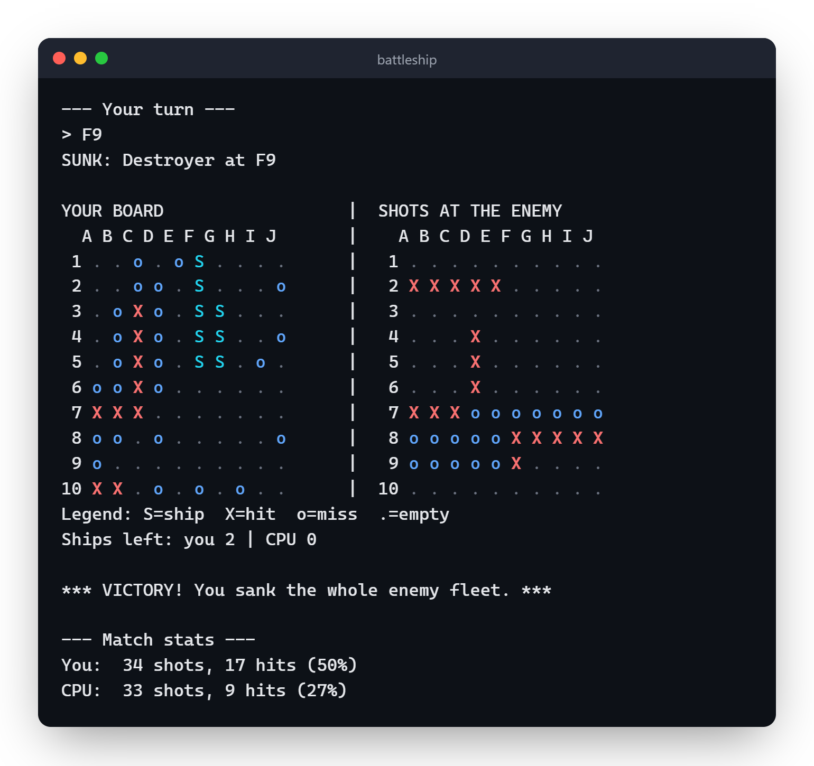

# Battleship


Battleship in the terminal, playing against the computer.

This project started as a `Main.java` with about 450 lines, everything in a single class. The idea was to refactor it and split the responsibilities into classes (board, ship, fleet, AI, printing...), loosely following SOLID.

## Running

You need JDK 17.

Linux/Mac:
```bash
javac -encoding UTF-8 -d out $(find src/main/java -name "*.java")
java -cp out battleship.Main
```

Windows (PowerShell):
```powershell
javac -encoding UTF-8 -d out (Get-ChildItem -Recurse src\main\java -Filter *.java).FullName
java -cp out battleship.Main
```

The tests don't use a framework, you just compile the whole `src` folder and run them:
```bash
javac -encoding UTF-8 -d out $(find src -name "*.java")
java -cp out battleship.BattleshipTest
```

## How to play

At the start it asks for a seed. If you leave it empty, the match is random; if you type a number, you can replay the same match later. Then it asks the difficulty (easy or normal, more on that below). Then you choose if you want to place the ships yourself or let it place them for you.

On your turn just type the coordinate, like `B7`, and it shoots. You can also see the match log or your board. Under the boards it lists the enemy ships still afloat, so you know if it's worth chasing that last cell or not. At the end it shows how many shots each side fired, the hit rate and the longest run of hits in a row, and asks if you want another match (it keeps the score while the program is open).

A match halfway through (seed 42):


And the end of a match won in 34 shots, with the stats for both sides:



You can see the AI at work: after hitting the ships on rows 7 and 10, it kept shooting around them until they sank.

The boards are colored when the game runs in a terminal. If you redirect the output to a file it goes without colors, and `NO_COLOR=1` turns them off.

The fleet is the classic one: carrier (5), battleship (4), cruiser (3), submarine (3) and destroyer (2).

## The AI

On normal the computer uses the "hunt and target" strategy:
- while it hasn't hit anything, it shoots more or less at random, but prefers the checkerboard cells, since every ship takes at least 2 cells
- once it hits something, it tries the neighboring cells until the ship sinks

On easy it just shoots at random and forgets what it hit (`RandomStrategy`). It's good for a first match, or to see how much the hunting part actually helps.

## Structure

```
src/main/java/battleship/
  Main.java, Game.java
  model/    Board, Ship, Fleet, ShotResult
  engine/   CoordParser, GameLog
  cpu/      CpuStrategy, HuntTargetStrategy, RandomStrategy
  ui/       BoardPrinter
```

`Game` depends on the `CpuStrategy` interface, so you can write another AI without touching the rest of the game.
